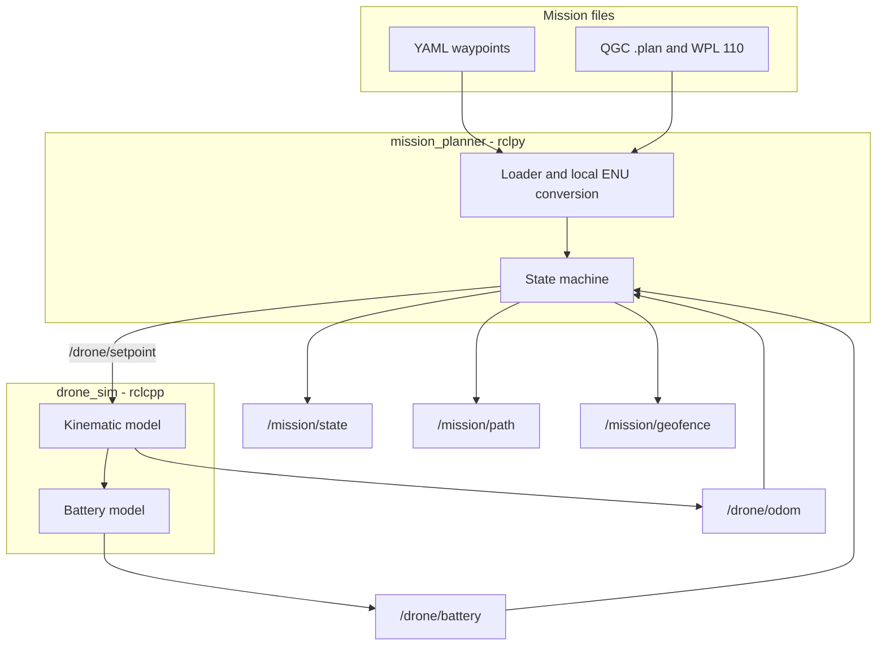
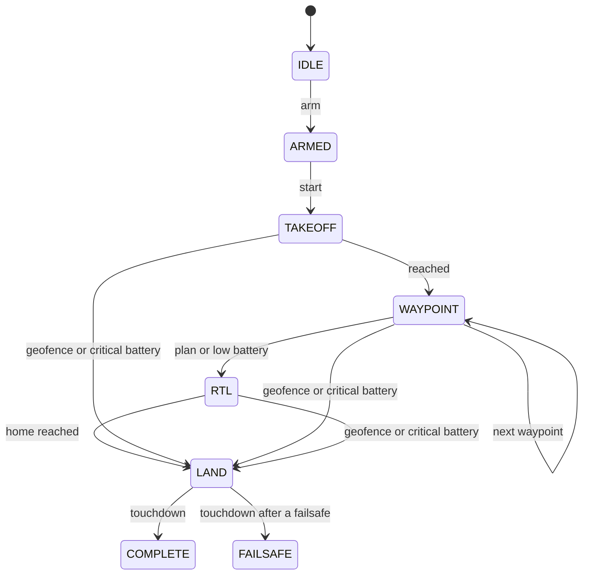

# ROS 2 drone waypoint mission demo

Portfolio project by [Arpan Bom](https://github.com/applycoding).

This is a small ROS 2 Jazzy workspace for a drone that flies a waypoint list in a kinematic simulator. The planner loads a mission, arms, takes off, tracks waypoints, returns home, and lands. A geofence breach or a low battery interrupts that plan. The simulator is a point mass with a speed limit and a first-order velocity lag. It publishes odometry, a TF frame, and a battery estimate.

It is a demo of package layout, interfaces, and testable control logic. It is not a flight controller. There is no Gazebo, PX4, ArduPilot, estimator, or hardware adapter, and nothing here should be put on a real aircraft.

## Features

- YAML missions, QGroundControl `.plan` JSON, and `QGC WPL 110` text
- Mission state machine: arm, takeoff, waypoints, RTL, land
- Failsafes: low battery returns home; critical battery or a cylinder geofence breach lands in place
- `rclpy` planner and `rclcpp` simulator, with the numeric cores free of ROS so they can be unit tested on a plain Ubuntu machine
- Custom messages, one service, and one action
- Launch file and an RViz config
- `pytest` and `gtest`, a Jazzy Docker image, and GitHub Actions (`ros-tooling/setup-ros` plus `colcon test`)

## Architecture





The planner publishes a position setpoint. The simulator tracks it. Cruise speed from the mission is the setpoint speed cap; the simulator also has its own default cap for commands that leave the cap unset.

## Layout

```text
src/interfaces       messages, LoadMission service, ExecuteMission action
src/mission_planner  loader, state machine, node, launch, sample missions
src/drone_sim        kinematic plant, battery model, simulator node
```

| Topic or service | Type | Role |
| --- | --- | --- |
| `/drone/setpoint` | `interfaces/Setpoint` | Position command and speed cap |
| `/drone/setpoint_pose` | `geometry_msgs/PoseStamped` | Same command, for RViz |
| `/drone/odom` | `nav_msgs/Odometry` | Simulated pose and body twist |
| `/drone/battery` | `interfaces/BatteryStatus` | Percent, a display voltage, drain |
| `/mission/state` | `interfaces/MissionState` | Phase, waypoint progress, failsafe |
| `/mission/path` | `nav_msgs/Path` | Loaded plan, latched |
| `/mission/geofence` | `interfaces/GeofenceStatus` | Cylinder check |
| `/mission/load` | `interfaces/LoadMission` | Load a file while disarmed or finished |
| `/mission/execute` | `interfaces/ExecuteMission` | Load, arm, and run; cancel lands |

TF is `odom` to `base_link`. The frame is local ENU, meters, with the mission home at the origin.

## Mission files

`missions/square.yaml` is an 8 m square at 5 m altitude. A `waypoints` list is expanded to takeoff, the waypoints, RTL, and land. An `items` list is flown as written (`takeoff`, `waypoint`, `rtl`, `land`).

QGC support is the subset this demo needs:

- Commands: `NAV_WAYPOINT` (16), `NAV_RETURN_TO_LAUNCH` (20), `NAV_LAND` (21), `NAV_TAKEOFF` (22)
- Frames: global AMSL (0), local NED (1), global-relative altitude (3)
- Simple items only. Survey and other complex items are rejected
- The first inclusion circle in `geoFence`, when present, becomes the horizontal cylinder. Altitude limits and battery thresholds are not in the QGC file; the loader uses documented defaults (100 m radius if there is no circle, altitude -1 m to 120 m, battery 25% / 10%)
- Latitude and longitude are converted with an equirectangular projection about the planned home. That is fine for a short mission and wrong for a long one
- A RTL or land item with coordinates left at zero is flown to the home point

## Failsafes

| Condition | Response | Terminal state |
| --- | --- | --- |
| Battery at or below `battery_failsafe_percent` during takeoff or a waypoint | RTL at `rtl_altitude_m`, then land | `FAILSAFE` |
| Battery at or below `battery_critical_percent` | Land at the current horizontal position | `FAILSAFE` |
| Outside the cylinder | Land at the current horizontal position | `FAILSAFE` |
| Action cancel | Land at the current horizontal position | `FAILSAFE` |
| Plan finishes on its own land item | Land at the planned point | `COMPLETE` |

Failsafes latch. A critical battery or a fence breach overrides an in-progress RTL. The planner will not start while the battery is already critical. Battery percentage is a scripted drain in the simulator: a hover term plus a term proportional to speed. The voltage field is a linear map across a 3S pack for display, not a cell model.

## Run

### Tests without ROS

```bash
sudo apt-get install python3-pytest python3-yaml g++ cmake libgtest-dev
./scripts/run_pure_tests.sh
```

### ROS 2 Jazzy workspace

```bash
source /opt/ros/jazzy/setup.bash
sudo rosdep init   # once per machine
rosdep update
rosdep install --from-paths src --ignore-src --rosdistro jazzy -y
colcon build
colcon test
colcon test-result --verbose
source install/setup.bash
ros2 launch mission_planner demo.launch.py
```

The square finishes in well under a minute. Watch `/mission/state`, or open RViz:

```bash
sudo apt-get install ros-jazzy-rviz2
ros2 launch mission_planner demo.launch.py use_rviz:=true
```

Other launch arguments: `mission_file`, `auto_start` (default `true`), and `battery_percent`. A low starting battery shows the RTL failsafe:

```bash
ros2 launch mission_planner demo.launch.py battery_percent:=22.0
```

Run a file through the action instead of auto-start:

```bash
ros2 launch mission_planner demo.launch.py auto_start:=false
ros2 action send_goal /mission/execute interfaces/action/ExecuteMission \
  "{mission_path: $(ros2 pkg prefix mission_planner)/share/mission_planner/missions/square.plan}"
```

### Docker

```bash
docker build -t drone-mission-sim .
docker run --rm drone-mission-sim
```

The image is `ros:jazzy-ros-base`. The build compiles the workspace and runs `colcon test`. The default command launches the demo without RViz.

## Tests

- `src/mission_planner/test` covers the loader, the equirectangular conversion, the geofence, yaw conversion, and the state machine, including the sample square. These tests do not import `rclpy`.
- `src/drone_sim/test` covers the kinematic plant and the battery drain with gtest. The same sources build from `src/drone_sim/standalone` when ROS is not installed, and from the ament package under `colcon test`.
- `.github/workflows/ci.yml` runs the pure tests on Ubuntu 24.04, then installs Jazzy with `ros-tooling/setup-ros` and runs `colcon build` and `colcon test`.

## Limitations

- Point-mass kinematics. No attitude loop, wind, ground effect, or obstacle avoidance
- One vertical cylinder. No polygon fence and no rally points
- QGC parser does not implement the full mission schema
- The battery model will not predict a real pack
- No simulation of GPS, barometer, or an offboard companion-computer link

## License

MIT. See [LICENSE](LICENSE).
