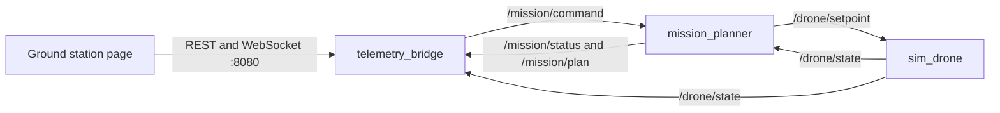
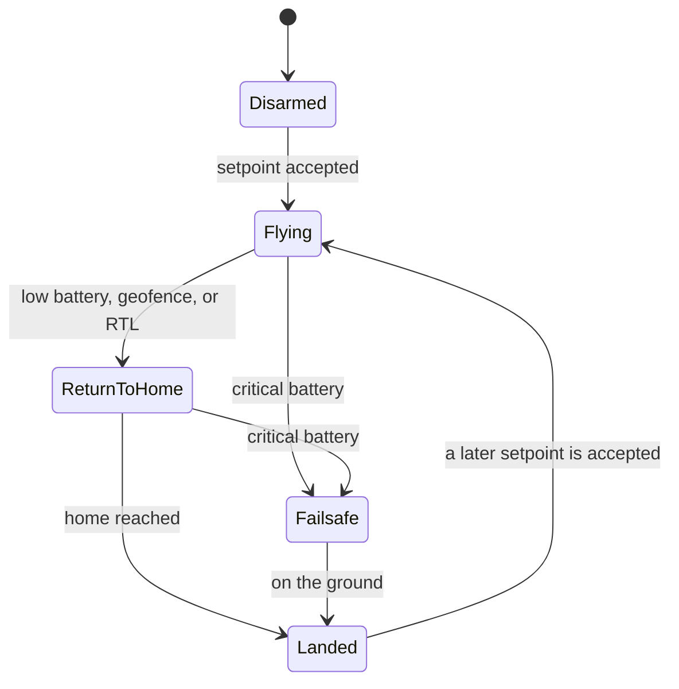
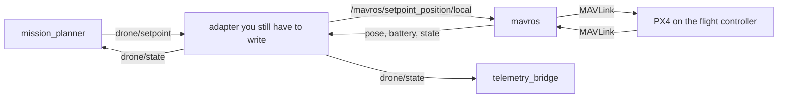

# Drone waypoint demo

A small ROS 2 Humble workspace that flies a waypoint mission on a **kinematic simulator**. It is a desktop demo of a companion-computer split: a mission planner, a vehicle node, and a ground-station bridge. It does not talk to PX4, MAVROS, or a real aircraft, and it is not a flight controller.

The vehicle node integrates a first-order velocity command. There is no mass, no rotors, no wind, and no estimator. Battery percentage and the geofence are bookkeeping so return-to-home can be exercised without Gazebo.

## Graph



`sim_drone` is the piece you would delete on a real companion computer. The planner and the bridge speak only `drone_msgs`.



Pilot return-to-home does not set `failsafe_active`. A battery or geofence return does. Critical battery descends while still moving toward home; an empty pack lands in place.

## Run the demo

The ground station listens on port 8080 with no authentication. Do not expose that port on a shared network.

### Docker

```bash
docker build -t drone-waypoint-demo .
docker run --rm -p 8080:8080 drone-waypoint-demo
```

Open `http://localhost:8080` and press Start. The default mission is a square in local ENU meters. Abort and Return both send the simulator home; they do not cut the simulated thrust.

A second launch uses a pack that crosses the return-to-home threshold shortly after takeoff:

```bash
docker run --rm -p 8080:8080 drone-waypoint-demo \
  ros2 launch drone_bringup failsafe_demo.launch.py
```

Load the GeoJSON sample instead of the YAML square:

```bash
docker run --rm -p 8080:8080 drone-waypoint-demo \
  ros2 launch drone_bringup mission_demo.launch.py \
  mission_format:=geojson \
  mission_file:=/ws/install/drone_bringup/share/drone_bringup/config/survey_square.geojson
```

Those coordinates are synthetic. They are not a surveyed pad.

### ROS 2 Humble on the host

The bridge needs Ubuntu's `python3-aiohttp` package. That name is not guaranteed to be in the default rosdep index, so install it with apt.

```bash
sudo apt update
sudo apt install -y \
  ros-humble-desktop \
  ros-humble-ament-cmake-gtest \
  python3-aiohttp python3-yaml python3-pytest python3-colcon-common-extensions
source /opt/ros/humble/setup.bash
colcon build
source install/setup.bash
ros2 launch drone_bringup mission_demo.launch.py
```

`ros-humble-desktop` is more than this demo needs. `ros-humble-ros-base` plus the message generators is enough, which is what the Docker image and CI use.

## Ground station

The page is served by `telemetry_bridge`.

| Method | Path | Role |
| --- | --- | --- |
| GET | `/` | Static page |
| GET | `/api/health` | Process is up, and whether drone and mission messages have arrived |
| GET | `/api/state` | Full snapshot |
| GET | `/api/mission` | Mission status plus the plan |
| POST | `/api/command` | JSON `{"command": "start" \| "abort" \| "rtl" \| "reload"}` |
| GET | `/ws` | Same snapshot, pushed about 5 times a second |

The page also polls `/api/state` so a dropped WebSocket does not freeze the instruments. Commands are queued and forwarded to `/mission/command` on the ROS executor. There is no login.

## Missions

YAML is already in the simulator frame. `x` is east, `y` is north, `z` is up, yaw is radians from east. Home in the file should match the simulator home. The sample uses the origin for both.

```yaml
frame: local_enu
home: {x: 0.0, y: 0.0, z: 0.0}
waypoints:
  - name: takeoff
    x: 0.0
    y: 0.0
    z: 8.0
    yaw: 0.0
    hold_sec: 2.0
    acceptance_radius: 0.7
```

GeoJSON is a `FeatureCollection` of `Point` features. `properties.home` is the local origin. Coordinates are `[lon, lat, alt]`. Altitude is meters above the home altitude. If `properties.alt` is set, it wins over the coordinate altitude. The projection is equirectangular about that home and is only believable over a few kilometers.

The planner will not advance a hold unless `/drone/state` says `mode` is `FLYING`. A vehicle that is already returning home cannot be counted as visiting the next waypoint.

## Topics and services

| Name | Type | Direction |
| --- | --- | --- |
| `drone/setpoint` | `drone_msgs/Waypoint` | Planner to vehicle |
| `drone/state` | `drone_msgs/DroneState` | Vehicle to planner and bridge |
| `mission/status` | `drone_msgs/MissionStatus` | Planner to bridge |
| `mission/plan` | `std_msgs/String` | JSON plan, transient-local |
| `mission/load` | `drone_msgs/LoadMission` | Replace the file when a mission is not running |
| `mission/command` | `drone_msgs/MissionCommand` | `start`, `abort`, `rtl`, `reload` |

`Waypoint.return_to_home` asks the simulator to use its own home. The XYZ in that message is what the page draws; the failsafe landing point is the simulator parameter `home_*`, which is also the geofence center.

Battery while airborne, in percent per second:

```text
idle + flight * clamp(max(speed_xy / v_xy_max, 0.25) + 0.25 * abs(vz) / v_z_max, 0, 1.5)
```

On the ground the value holds, unless `recharge_percent_per_sec` is set. That recharge exists so the demo can be started again. It is not a battery model.

## Tests

```bash
source /opt/ros/humble/setup.bash
colcon test --return-code-on-test-failure
colcon test-result --verbose
```

`drone_sim_core` uses gtest: tracking, speed limit, battery, geofence, altitude limit, pilot RTL, and the refusal to arm on a critical pack. `mission_planner` uses pytest for YAML, GeoJSON, the equirectangular conversion, and the sequencer. `telemetry_bridge` uses pytest for the snapshot store and the HTTP/WebSocket API.

CI (`.github/workflows/ci.yml`) builds and runs those tests inside `ros:humble-ros-base`, then launches the nominal demo and checks that the page comes up and the vehicle climbs after Start.

## What would change on a Jetson or Raspberry Pi

On a companion computer the planner and the bridge can stay. `sim_drone` is replaced by an adapter in front of MAVROS. This repository does not include that adapter.



Practical notes, none of which this demo implements:

- PX4 OFFBOARD times out if position setpoints stop. The planner already repeats the active setpoint at 10 Hz. The adapter has to keep forwarding that stream, usually at 10 Hz or faster, into MAVROS.
- This demo arms itself when a setpoint arrives. A real adapter must not. Arming and the OFFBOARD switch stay with the pilot, or with whatever preflight checks you add on top.
- Return-to-home here is a mode inside the toy model. On a vehicle it is a request, typically `MAV_CMD_NAV_RETURN_TO_LAUNCH` through `/mavros/cmd/command`, or a mode change to RTL. The companion should not also try to fly the attitude loop.
- The geofence in this repo is a horizontal circle plus an altitude band around the simulator home. PX4 has its own fence. A companion check is a second layer that *requests* RTL. It is not a substitute for the fence on the flight controller.
- Frame alignment matters. `drone/setpoint` is local ENU. MAVROS local position is the EKF origin. Those origins have to be the same point, or the adapter has to convert. The GeoJSON loader's equirectangular step is a demo convenience, not a navigator.
- The serial port is different per board. Jetson UART is often `/dev/ttyTHS1`; a Pi is often `/dev/ttyAMA0` or `/dev/serial0`. Ethernet MAVLink is the other common path. Either way the flight controller owns the motors.
- Wall time is fine for this kinematic loop. Do not integrate a second estimator from it and then fight the EKF.

Nothing in this repo has been flown. Do not point `sim_drone` at an airframe.

## Layout

```text
src/drone_msgs          messages and services
src/drone_sim_core      C++ kinematic model and gtest
src/sim_drone           ROS node around that model
src/mission_planner     YAML/GeoJSON loader, sequencer, ROS node
src/telemetry_bridge    HTTP, WebSocket, ground-station page
src/drone_bringup       launch files and sample missions
```

## License

Apache-2.0. See [LICENSE](LICENSE).
